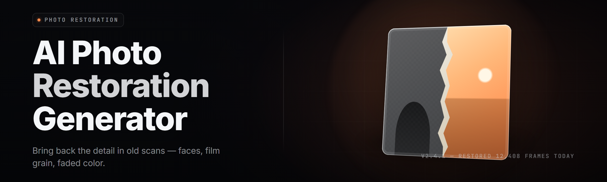

  
  
  

  

  
  

---

**AI Photo Restoration Generator — 2026**

Restore, upscale, de-noise, and colorize damaged photographs with a local neural pipeline. Download, extract, run the `.exe`. No accounts, no uploads, no cloud round-trip.

---

## 📸 Overview

| Category | Details |
|---|---|
| Product | AI Photo Restoration Generator |
| Release | v2.4.1 (2026) |
| Platform | Windows 10 / 11 (x64) |
| Runtime | Bundled CUDA + CPU fallback, no external install |
| Input formats | JPG, PNG, TIFF, BMP, WEBP, HEIC, RAW (CR2, NEF, ARW) |
| Output formats | PNG, TIFF, JPG (quality 1–100), WEBP |
| Processing | Fully offline, GPU-accelerated |
| Distribution | Portable `.exe`, extract-and-run |

The AI Photo Restoration Generator is a desktop restoration studio that runs an ensemble of neural models — face restoration, super-resolution, denoise, scratch repair, and colorization — over scanned or photographed prints. Drop a folder in, walk away, come back to a restored set. Everything runs on your machine; nothing leaves the disk.

---

## 🔍 What Is the AI Photo Restoration Generator

| Term | Explanation |
|---|---|
| Restoration pass | A single neural model applied to an image (denoise, face, upscale, color) |
| Pipeline | An ordered stack of passes chained together (e.g. denoise → face → upscale) |
| Face model | Specialized network that reconstructs facial detail lost to blur or grain |
| Upscale factor | Multiplier applied to output resolution (2x, 4x, 8x) |
| Scratch mask | Auto-detected region of physical print damage flagged for inpaint |
| Colorization | Predictive chroma inference for grayscale or sepia source images |
| Batch queue | A folder-level job list processed sequentially or in parallel |

- Runs entirely offline — no telemetry, no cloud sync, no account gate
- Handles prints, scans, phone captures, and museum-grade TIFF at once
- Preserves EXIF and sidecar metadata through the restore pass
- Ships a preset library for common damage classes (faded, torn, water-damaged, silvered)
- Exports a side-by-side comparison strip for every processed image

---

## 🧩 All Modules Status

| Module | Status | Description |
|---|---|---|
| denoise\_cascade | ✅ Working | Multi-scale grain and JPEG artifact suppression |
| face\_restore\_v3 | ✅ Working | Facial feature reconstruction with identity lock |
| upscale\_esrgan | ✅ Working | 4x/8x super-resolution via ESRGAN-class network |
| colorize\_chroma | ✅ Working | Grayscale-to-color inference with palette control |
| scratch\_inpaint | ✅ Working | Masked region fill for tears, creases, dust |
| deblur\_motion | ✅ Working | Directional and gaussian blur recovery |
| exposure\_balance | ✅ Working | Histogram normalization and tone curve recovery |
| sepia\_correct | ✅ Working | Silvered/yellowed print color cast reversal |
| jpeg\_repair | ✅ Working | Blocking and ringing artifact removal |
| red\_eye\_fix | ✅ Working | Automated pupil detection and chroma replacement |
| metadata\_keeper | ✅ Working | EXIF/IPTC preservation through the pipeline |
| batch\_scheduler | ✅ Working | Folder-level job queue with priority lanes |
| preset\_engine | ✅ Working | Named pipeline presets with parameter overrides |
| compare\_strip | ✅ Working | Auto-generated before/after contact sheet |
| raw\_decode | ✅ Working | Camera RAW ingest via embedded decoder |
| heic\_ingest | ✅ Working | HEIC/HEIF container support |
| tiff\_writer | ✅ Working | 16-bit TIFF output for archival workflows |
| gpu\_dispatcher | ✅ Working | CUDA/ROCm/DirectML backend selection |
| cpu\_fallback | ✅ Working | Full pipeline on CPU when no GPU present |
| cache\_layer | ✅ Working | Intermediate tensor cache to skip repeated passes |
| watch\_folder | ✅ Working | Filesystem watcher for auto-restore of new drops |
| profile\_manager | ✅ Working | Per-project settings and named user profiles |
| crash\_guard | ✅ Working | Job-level isolation so one bad file can't kill a batch |

  

---

## 🎛️ Key Features

| Feature | Description | Benefit |
|---|---|---|
| One-click preset restore | Applies a tuned pipeline to a whole folder | Zero config for first-time users |
| Identity-locked face pass | Face model preserves subject likeness | Restores detail without changing who it is |
| 8x super-resolution | ESRGAN-class upscale to archival size | Print-ready output from small scans |
| Predictive colorization | Infers chroma from luminance and context | Brings old B&W portraits back to life |
| Scratch/tear inpaint | Auto-masks and fills physical damage | Saves hours of manual cloning |
| Motion deblur | Recovers handheld and scan smear | Salvages the "unusable" shots |
| Batch queue | Parallel job scheduling with pause/resume | Hundreds of photos overnight |
| Side-by-side strip | Auto contact sheet per job | Instant proof for client review |
| Watch folder | Auto-processes new file drops | Set-and-forget workflow |
| GPU/CPU dispatch | Picks the best backend per machine | Runs on laptops and workstations alike |
| Metadata preservation | EXIF kept through every pass | No lost shooting data |
| 16-bit TIFF output | Archival-grade export | Museum and print lab ready |

---

## 🚧 The Problem

- Old prints fade, silver, and yellow long before the image is truly gone — but the damage is baked into the scan.
- Consumer upscalers blur faces into wax; identity is lost the moment the model guesses.
- Cloud restoration services require uploading family photos to a third-party server with opaque retention.
- Manual restoration in Photoshop is a per-image craft that doesn't scale past a dozen photos.
- Scanned RAW and HEIC files get mangled by pipelines that assume JPG input.
- Tear and scratch repair is the slowest, most tedious part of any restoration job.
- Batch tools that exist drop metadata, flatten color depth, or refuse to run offline.

---

## 🛠️ The Solution

| Problem | Solution |
|---|---|
| Faded/silvered prints | sepia\_correct + exposure\_balance restore tone and chroma |
| Face destruction in upscale | face\_restore\_v3 with identity lock runs before upscale |
| Cloud privacy risk | Fully offline pipeline, no network calls, no telemetry |
| Manual per-image work | preset\_engine + batch\_scheduler process folders unattended |
| RAW/HEIC unsupported | raw\_decode + heic\_ingest handle native containers |
| Slow scratch repair | scratch\_inpaint auto-masks and fills damage regions |
| Metadata loss | metadata\_keeper preserves EXIF/IPTC end to end |

---

## ⚙️ Apply Modules — Grouped Catalog

### **Denoise & Repair** 🧽

1. **denoise\_cascade** — layered grain and artifact suppression across scales.
2. **jpeg\_repair** — removes blocking and ringing from over-compressed sources.
3. **scratch\_inpaint** — fills tears, creases, and dust using masked inference.
4. **deblur\_motion** — recovers directional smear from handheld and scan blur.
5. **red\_eye\_fix** — detects and replaces pupil chroma automatically.

### **Face & Detail** 👤

1. **face\_restore\_v3** — reconstructs facial features with identity preservation.
2. **detail\_enhance** — micro-contrast and texture recovery on fabric, hair, foliage.
3. **eye\_sharp** — targeted sharpening on irises and catchlights.
4. **skin\_smooth\_guard** — prevents over-smoothing on restored faces.

### **Upscale & Output** 📐

1. **upscale\_esrgan** — 2x/4x/8x super-resolution with tiled inference.
2. **tiff\_writer** — 16-bit archival TIFF export.
3. **resize\_smart** — context-aware downscale that preserves edges.
4. **watermark\_stamp** — optional non-destructive proof mark on exports.

### **Color & Tone** 🎨

1. **colorize\_chroma** — predictive colorization with palette control.
2. **exposure\_balance** — histogram and tone curve recovery.
3. **sepia\_correct** — reverses yellowing and silvering on aged prints.
4. **white\_balance** — neutralizes scan color cast.

### **Pipeline & Automation** 🔄

1. **preset\_engine** — named pipelines with per-parameter overrides.
2. **batch\_scheduler** — folder-level queue with priority lanes.
3. **watch\_folder** — auto-restore new file drops.
4. **profile\_manager** — per-project and per-user settings.
5. **compare\_strip** — auto before/after contact sheets.
6. **cache\_layer** — skips repeated passes on identical inputs.

---

## 📊 Comparison

| Aspect | Cloud Restorer | Generic Upscaler | This Tool |
|---|---|---|---|
| Privacy | Uploads to server | Local | Fully offline |
| Face fidelity | Often wax-like | Blurs faces | Identity-locked |
| Scratch repair | Manual | None | Auto-inpaint |
| Batch scale | Rate-limited | Basic | Unlimited local |
| RAW/HEIC | Rarely | Partial | Native |
| Metadata | Stripped | Sometimes | Preserved |
| Cost | Subscription | One-time | Free, open source |
| Output depth | 8-bit JPG | 8-bit | 16-bit TIFF |

---

## 🚀 Quick Start

1. 📄 Visit the project page and grab the latest release archive.
2. 📦 Extract the archive to a folder of your choice (no installer, no admin prompt).
3. 🖱️ Run the `.exe` inside the extracted folder.
4. 🗂️ Drag a folder of photos onto the window, or point the watch folder at one.
5. 🎚️ Pick a preset (or build a custom pipeline), hit **Restore**, and let the queue run.

---

## 🖥️ System Requirements

| Component | Minimum | Recommended |
|---|---|---|
| OS | Windows 10 x64 (1909+) | Windows 11 x64 |
| CPU | 4-core, SSE4.2 | 8-core+ with AVX2 |
| RAM | 8 GB | 16 GB+ |
| GPU | None (CPU fallback) | NVIDIA RTX 20-series+ / 8 GB VRAM |
| Disk | 2 GB free | 10 GB+ SSD for batch cache |
| Display | 1280×720 | 1920×1080+ |
| Runtime | Bundled | Bundled |

---

## 📥 Installation

1. **Download the release archive** from the project landing page. The archive contains the portable `.exe` and its bundled runtime — no separate dependencies.
2. **Extract** to a writable folder. Avoid Program Files if you want the cache and watch-folder features to work without elevation.
3. **Run the `.exe`.** First launch runs a quick backend probe and selects CUDA, DirectML, or CPU automatically.

---

## 🐞 Known Issues

| Issue | Solution |
|---|---|
| First run is slow | One-time model warmup; subsequent runs are fast |
| CPU-only mode is slow on 8x | Use 2x/4x on CPU, or install a GPU |
| HEIC import errors on old Windows | Enable HEIF support in Windows Store, or convert to TIFF |
| Batch stalls on a corrupt file | crash\_guard isolates the job; check the log and skip |
| Colorization looks oversaturated | Lower chroma strength in the colorize\_chroma panel |
| Watch folder misses network drives | Use a local path or a synced folder |

---

## ❓ FAQ

### 1. Do I need to install Python, CUDA, or anything else?
No. The `.exe` ships with its runtime and model weights bundled. Extract and run — that's the whole setup.

### 2. Are my photos uploaded anywhere?
No. The AI Photo Restoration Generator runs entirely offline. There are no network calls, no telemetry, and no account requirement.

### 3. How long does a restore take?
A single 4x upscale on a modern GPU takes a few seconds per image. A batch of 500 photos overnight is a normal workload.

### 4. Can it restore faces without changing who the person is?
Yes. The face\_restore\_v3 module uses an identity-lock pass that constrains output to the subject's own likeness.

### 5. Does it work on RAW and HEIC files?
Yes. raw\_decode handles common camera RAW containers, and heic\_ingest covers HEIC/HEIF from phones.

### 6. What output formats are available?
PNG, JPG, WEBP, and 16-bit TIFF for archival workflows.

### 7. Is there a command-line mode?
Yes. The `.exe` accepts a `--batch` flag with a folder path and preset name for headless runs.

### 8. Does it preserve EXIF data?
Yes. metadata\_keeper carries EXIF and IPTC through the entire pipeline to the output file.

### 9. Can I run it on a laptop without a dedicated GPU?
Yes. cpu\_fallback runs the full pipeline; expect slower throughput, especially at 8x.

### 10. Is it really free?
Yes. MIT-licensed, no subscription, no per-image limits.

---

## 🧭 Troubleshooting Flow

Start → Does the `.exe` launch? → **No:** check Windows Defender quarantine, then re-extract. → **Yes:** Does it detect a GPU? → **No:** confirm drivers, else it runs on CPU. → **Yes:** Does the batch stall? → **Check the log pane**, isolate the failing file, re-run the rest. → **Still stuck:** lower upscale factor and re-test on a single image.

---

## 🏁 Get Started

The AI Photo Restoration Generator exists because photos deserve a second life, and the tools to give them one shouldn't require a subscription or a server farm. Everything runs on your machine, the models are tuned for real damage, and the output is archival-grade. Extract it, point it at a folder, and watch the past come back in focus.

  

